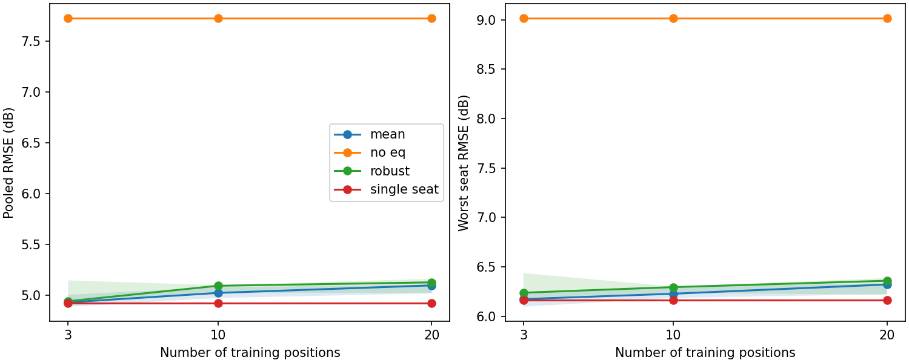
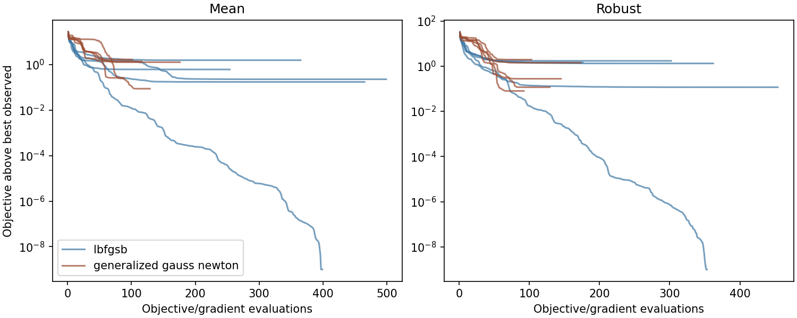

# Robust Multi-Position Parametric Room Equalization

This project designs one parametric equalizer for multiple listening positions.
It uses measured room impulse responses to fit the equalizer and tests how
well the same correction works at positions that were held out of the fit.

## How it works

1. Convert measured MeshRIR impulse responses to decibel magnitudes at 128
   logarithmically spaced frequencies between 50 and 500 Hz. Use a common level
   reference from the training data.
2. Fit a cascade of six peaking biquads with bounded gain, center frequency,
   and Q. The mean objective averages errors across seats. The robust
   objective mixes the average with a smooth approximation of the worst-seat error.
3. Compare a custom projected, damped generalized Gauss–Newton solver with
   SciPy L-BFGS-B using the same starts and bounds. Evaluate no EQ, single-seat
   EQ, mean EQ, and robust EQ on a fixed spatial holdout.

The spatial experiment uses one source and one horizontal plane. It keeps
126 test positions at least 25 cm from the training positions and repeats
the comparison with 3, 10, and 20 training positions.
[Model and derivation](report/room_equalization.pdf) · [Split IDs and settings](results/main/manifest.json)

## Results

### Held-out room response

With 20 training positions, mean EQ reduced median pooled RMSE from **7.73
to 5.10 dB** on the held-out strip. The single-seat baseline also performed
well on this strip.

| Method | Pooled RMSE | Worst-seat RMSE |
| --- | ---: | ---: |
| No EQ | 7.73 dB | 9.02 dB |
| Single-seat EQ | 4.93 dB | 6.17 dB |
| Mean EQ | 5.10 dB | 6.32 dB |
| Robust EQ (α = 0.5) | 5.13 dB | 6.36 dB |

Values are medians across three training selections. Pooled RMSE combines
errors across seats and frequencies. Worst-seat RMSE is the largest individual
seat RMSE. [Full spatial scores](results/main/scores.csv)



Across all nine paired spatial comparisons, robust EQ improved worst-seat
RMSE over mean EQ in **7 of 9 training comparisons** and **2 of 9 holdout
comparisons**. The median change was −0.036 dB in training and +0.064 dB on
the holdout. [Paired results](results/ablation/paired_spatial.csv) · [Spatial error map](results/main/spatial_map.png) · [Mean versus worst-seat tradeoff](results/main/tradeoff.png)

### Solver comparison

All 20 matched fits reached the shared projected-gradient tolerance.
Gauss–Newton used fewer joint objective and gradient calls at the median.
Its calls also computed curvature. L-BFGS-B reached the lowest observed
objective for both losses. [Solver summary](results/main/solver_summary.csv)

| Loss | Median calls, Gauss–Newton | Median calls, L-BFGS-B |
| --- | ---: | ---: |
| Mean | 116 | 399 |
| Robust | 129 | 353 |



### Initialization and temperature

| Experiment | Result |
| --- | --- |
| Temperature continuation | The selected 32 → 8 → 2 dB² schedule improved the final objective on 1 of 5 starts. Median calls rose from 129 to 233. [Run results](results/ablation/continuation_runs.csv) |
| Peak-informed initialization | Peak placement lowered the starting objective against the median random-center start on 9 of 9 spatial splits and lowered the final objective on 4 of 9. It used a median of 18 more calls in the paired comparison. [Per-split results](results/initialization/summary.csv) |

The [project record](PROJECT_RECORD.md) includes the result audit and scope
limitations. The [original research plan](PROJECT_SPEC.md) outlines the planned
experiments.

## Setup on Windows

Use Python 3.13 and uv. From the project root, run these commands to recreate the local
environment, obtain the data, and verify the setup.

```powershell
uv sync --locked --python 3.13 --cache-dir .uv-cache
.\.venv\Scripts\room-eq-data.exe
.\.venv\Scripts\python.exe -m pytest -q -p no:cacheprovider
.\.venv\Scripts\room-eq-smoke.exe
```

The data command requires curl. It downloads the 995.8 MB MeshRIR single-source
NumPy archive, resumes partial downloads, checks the published MD5, and validates
the response layout. With the archive already installed, add `--verify-only` to
check the local copy. The loader reads measurements directly from the ZIP.

MeshRIR is by Shoichi Koyama, Tomoya Nishida, Keisuke Kimura, Takumi Abe, Natsuki Ueno,
and Jesper Brunnström and is licensed under CC BY 4.0. The pinned release is
v1.2 and the archive lives at `data/raw/S1-M3969_npy.zip`.
[Dataset release](https://zenodo.org/records/10852693) · [Dataset documentation and license](https://www.sh01.org/MeshRIR/)

## Run individual experiments

### Smoke experiment

The default [configuration](configs/smoke.yaml) fits six peaking filters over
50–500 Hz using nine training positions and evaluates them on twelve disjoint
positions on the same MeshRIR plane. A single training-derived level reference is
applied across seats. The random split checks the pipeline for nearby unmeasured
positions. Use spatially separated holdouts for the main experiment.

The run writes `summary.json`, `filters.csv`, `seats.csv`, `spectra.npz`, and
`responses.png` under `results/smoke/`. Pass `--config` or `--output` for a separate
run. The reported combined boost is a diagnostic. The optimizer enforces
individual filter bounds.

The first smoke run reached the 300-evaluation budget. The configuration now
allows 1,500 evaluations so SciPy can reach its stopping tolerance.

### Solver and spatial experiments

```powershell
.\.venv\Scripts\python.exe -m room_eq.experiments
```

[The main configuration](configs/main.yaml) uses two protocols on the middle
MeshRIR plane:

- The matched solver benchmark uses the smoke split, five shared starts, the
  mean and robust objectives, and the same box bounds and projected-gradient
  tolerance for L-BFGS-B and generalized Gauss–Newton.
- The spatial experiment reserves the 126 positions at x ≥ 0.25 m and draws
  nested sets of 3, 10, and 20 positions at x ≤ 0 m using three seeds.
  The center position supplies the common level reference and the single-seat
  baseline. L-BFGS-B uses three starts per objective, and the lowest
  training objective determines which fit to report.
  The robust loss sweeps alpha from 0 to 1 at a fixed temperature of 2 dB².

The command saves split IDs and configuration in `results/main/manifest.json`.
See `solver_summary.csv` for the matched comparison, `runs.jsonl` for fits and
convergence traces, and `scores.csv` for training and held-out metrics.
The generated figures show convergence, the mean/worst-seat tradeoff,
performance versus training count, and the spatial error map.
The solver figure uses the best observed objective as a plotting reference.
Reported evaluation counts refer to joint objective and gradient calls.
Gauss–Newton also evaluates curvature at its trial points, tracked separately.

### Continuation ablation

After running the main experiment, run the ablation and paired spatial analysis:

```powershell
.\.venv\Scripts\python.exe -m room_eq.ablation
```

[The ablation configuration](configs/ablation.yaml) defines the candidate
schedules and pilot seeds. The pilot reads only the matched training seats.
The selected schedule and fixed-temperature fits use the same five starts,
Gauss–Newton implementation, final temperature, and total evaluation cap.
Results go to `results/ablation/`. The continuation JSON Lines file records
each stage's allocation and trace. The paired CSV reports robust minus mean
RMSE for each spatial seed and training count.

### Peak initialization

```powershell
.\.venv\Scripts\python.exe -m room_eq.peak_ablation
```

The peak-informed start places six cuts at separated positive peaks of the
median training response. It is compared with five seeded random-center
starts with matched initial gains and Q and with a separate near-flat
reference. All fits use the same robust objective at the fixed final
temperature and the same Gauss–Newton settings. See
`results/initialization/summary.csv` for per-split results and `runs.jsonl`
in that folder for all parameters and traces.

## Reproducing results and documents

After installing dependencies and obtaining the dataset, run this command
from the project root:

```powershell
.\.venv\Scripts\python.exe scripts\reproduce.py
```

The repository includes the published result tables and run traces. The raw
MeshRIR archive and local environments are downloaded or created during setup.
The reproduction command verifies the archive and regenerates the smoke test, main solver and
spatial experiments, continuation and paired analysis, and initialization
ablation. Objective values and metrics are deterministic for the pinned
environment. Wall-clock times can vary.

The [course report](report/room_equalization.pdf) describes the methods and
results. For a 17-minute presentation, use the [slide deck](presentation/room_equalization_slides.pdf)
and [timed notes](presentation/speaker_notes.txt). With pdfLaTeX and Latin
Modern fonts installed, rebuild the documents after generating the results:

```powershell
pdflatex -interaction=nonstopmode -halt-on-error -output-directory=report report/room_equalization.tex
pdflatex -interaction=nonstopmode -halt-on-error -output-directory=report report/room_equalization.tex
pdflatex -interaction=nonstopmode -halt-on-error -output-directory=presentation presentation/room_equalization_slides.tex
```
